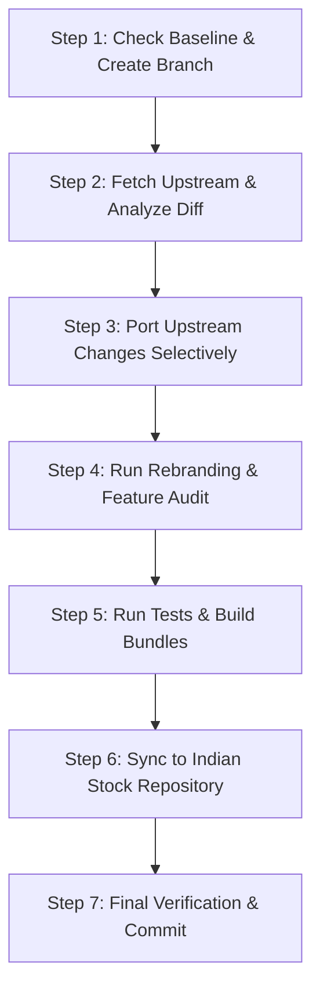

# AI Agent Instructions: Upstream OpenAlgo Upgrade & Feature Porting Protocol

This document is the **authoritative protocol for any AI agent** (Antigravity, Claude Code, Cursor, Windsurf, Copilot, ChatGPT, etc.) tasked with pulling, porting, or merging new features, updates, or bug fixes from the upstream **OpenAlgo** repository (`https://github.com/marketcalls/openalgo.git`) into **Tradeboard**.

---

## 1. Fundamental Mission & Invariants

**Tradeboard** is an independent, enhanced, production-grade algorithmic trading platform built by **Rajeev** ([rockstarrajeev](https://github.com/rockstarrajeev)).

When upgrading or porting features from upstream OpenAlgo, the AI agent must adhere to this golden rule:
> **"Adopt all genuine functional enhancements, new broker integrations, and upstream bug fixes, while strictly preserving Tradeboard's brand identity, user interface innovations, security hardenings, and custom features."**

---

## 2. The Tradeboard Protected Shield (NEVER Overwrite)

The following components are protected. Any modification that overwrites, degrades, or reverts these components is considered an **unauthorized regression**:

### A. Rebranding & Owner Identity
1. **Brand Name**: Always **Tradeboard**. Never revert page titles, navigation bars, headers, footers, docstrings, systemd services, or startup scripts to "OpenAlgo".
2. **Author & Repository**:
   - GitHub Repository: `https://github.com/rockstarrajeev/tradeboard`
   - Author Profile: `https://github.com/rockstarrajeev`
3. **Social & Support Links**:
   - LinkedIn profile linked on Login page and footers.
   - Discord links removed or replaced with Tradeboard channels.
4. **Visual Branding & Logos**:
   - Logo assets (`frontend/public/logo.png`, `frontend/public/chart-logo.png`, `softcorp-full-logo.png`, favicons).
   - Post-login sidebar and header branding (Tradeboard logo and title visible both before and after login).
   - Chart watermark emblem in `frontend/src/lib/trading/chartLogo.ts` and `frontend/src/lib/trading/terminal.ts`.

### B. User Interface Innovations & Styling
1. **Glassmorphism & Gradient Card Layouts**:
   - The modern animated gradient cards and hover effects on:
     - `/dashboard`
     - `/platforms`
     - `/logs`
     - `/tools`
     - `/login`
2. **Post-Login Sidebar & TopNav Layouts**:
   - Brand logo and title remaining visible after authentication.
3. **Typography & Styling**:
   - Retain custom styling tokens, animations, and Tailwind/vanilla CSS transitions.

### C. Custom Added Features ("Tradeboard Superpowers")
1. **Crypto Derivatives Integration**:
   - Delta Exchange broker adapter (`broker/delta/` or crypto handlers), crypto symbols, order routing, and WebSocket endpoints.
2. **3D Strategy Builder & Options Leg Dialogs**:
   - `frontend/src/components/strategy-builder/EditLegDialog.tsx` with `invalidateIvWhenContractChanges()` logic to protect and dynamically manage IV values during contract edits.
3. **Voice & Visual AI Agent**:
   - OpenUI visualizer library (`frontend/src/lib/agent/openuiLibrary.ts`), prompt files, and agent visualization components.
4. **Historify DuckDB Engine**:
   - Historical analytics and DuckDB data processing pipelines.
5. **Production Security Hardenings**:
   - `blueprints/admin.py`: Secure file handling using `tempfile.NamedTemporaryFile` with `try...finally` cleanup (prevents Windows path failure and symlink attacks) and strict loopback URL scheme validation (`http://` or `https://`).
   - `blueprints/python_strategy.py`: Owner-only `0o700` (`S_IRWXU`) permissions on strategy files/directories, and stream-safe exit handler `_is_stream_open()` in `cleanup_on_exit()` (prevents `ValueError: I/O operation on closed file`).
   - `websocket_proxy/app_integration.py`: Safe `eventlet` guard (`if "eventlet" not in sys.modules: return False`).
   - `csp.py` & `app.py`: Hardened CSP headers (`X-Frame-Options: DENY`, `X-Content-Type-Options: nosniff`, `Permissions-Policy`, `Referrer-Policy`).

### D. Preserved Compatibility Exceptions
To avoid breaking external tools and existing client strategies, retain these compatibility bindings:
- **PyPI SDK Name**: The external Python client SDK package remains `openalgo` (`pip install openalgo`, `from openalgo import api`).
- **Environment Variables**: Subprocess strategy runner env vars (`OPENALGO_API_KEY`, `OPENALGO_STRATEGY_EXCHANGE`, `OPENALGO_HOST`).
- **Database & Cryptography**: The default SQLite database path `db/openalgo.db` and static Fernet salt `b"openalgo_static_salt"` must NOT be renamed (renaming would corrupt existing user databases and API key decryption).

---

## 3. Step-by-Step AI Upgrade Protocol

When the user asks to upgrade or merge features from OpenAlgo, follow these exact 7 steps:



### Step 1: Pre-Upgrade Safety Check & Branch Creation
1. Ensure the working tree is clean:
   ```bash
   git status
   ```
2. Run the audit script to verify the baseline is green:
   ```bash
   python scripts/audit_rebranding.py
   ```
3. Create an isolated upgrade branch:
   ```bash
   git checkout -b feature/upstream-upgrade-<version_or_date>
   ```

### Step 2: Fetch Upstream & Inspect Changes (DO NOT Blindly Merge)
**NEVER execute `git merge openalgo/main` or `git pull` without reviewing!** Blind merges will overwrite Tradeboard branding and custom UI components.
1. Fetch latest changes from upstream:
   ```bash
   git fetch openalgo
   ```
2. Inspect the commits:
   ```bash
   git log --oneline HEAD..openalgo/main -n 20
   ```
3. Inspect which files changed:
   ```bash
   git diff HEAD..openalgo/main --stat
   ```
4. Categorize files:
   - **Type A: Pure Additions** (e.g. new broker file `broker/newbroker.py`, new indicator function) $\rightarrow$ Port directly.
   - **Type B: Core Shared Code** (e.g. `app.py`, `blueprints/`, `frontend/src/`) $\rightarrow$ Perform line-by-line 3-way merge, keeping Tradeboard enhancements intact.
   - **Type C: Brand & UI Protected** (e.g. `frontend/src/pages/Login.tsx`, `index.html`, `README.md`, `PRD.md`, `CLAUDE.md`, logos) $\rightarrow$ DO NOT overwrite with upstream. Only extract technical or functional updates if relevant.

### Step 3: Porting Upstream Changes
- **Backend API & Brokers**:
  - Add new broker endpoints or handlers.
  - Verify that Delta Exchange (Crypto) routes in `app.py` and `broker/` remain intact.
  - Keep `NamedTemporaryFile` in `blueprints/admin.py` and `_is_stream_open()` in `blueprints/python_strategy.py`.
- **Database Migrations**:
  - Check if upstream added new migrations under `upgrade/`.
  - Ensure migration numbers do not collide with Tradeboard custom tables.
  - Test migrations: `python upgrade/migrate_all.py`.
- **Frontend Components**:
  - Incorporate upstream bug fixes or UI components.
  - Verify that the glassmorphism gradient styles, card animations, and hover effects on Dashboard, Platforms, Logs, and Tools are NOT replaced with flat or plain layouts.
  - Ensure `EditLegDialog.tsx` retains `invalidateIvWhenContractChanges`.

### Step 4: Run Rebranding & Feature Integrity Audit
Always run the automated integrity audit script:
```bash
python scripts/audit_rebranding.py
```
If any check fails, fix the regression before proceeding.

### Step 5: Automated Tests & Bundle Build
Run the full validation suite:
```bash
# 1. Production security checks
pytest test/test_production_security.py -v

# 2. Frontend unit tests
cd frontend
npm test
# 3. Production bundle compilation
npm run build
cd ..

# 4. Static asset precompression
python -m utils.precompress_assets

# 5. Database migrations check
python upgrade/migrate_all.py
```
All commands must exit with code 0 without errors.

### Step 6: Multi-Repository Parity Sync
Tradeboard exists in two synchronized repository trees:
1. **Crypto Version**: `d:\Code\Antigravity\My_Projects\tradeboard`
2. **Indian Stock Version**: `D:\Code\VS Code\tradeboard`

Every change made to the Crypto version must be mirrored to the Indian Stock version:
1. Copy updated files to `D:\Code\VS Code\tradeboard`.
2. Run the audit script in the Indian Stock repo:
   ```bash
   cd "D:\Code\VS Code\tradeboard"
   python scripts/audit_rebranding.py
   ```
3. Run tests and build the bundle in the Indian Stock repo:
   ```bash
   pytest test/test_production_security.py
   cd frontend && npm run build && cd ..
   python -m utils.precompress_assets
   ```

### Step 7: Final Verification & Clean Commit
1. Verify `git status` and `git diff` in both repositories.
2. Commit with clear, descriptive messages:
   ```bash
   git commit -m "feat: port upstream OpenAlgo <version> features while preserving Tradeboard branding and custom modules"
   ```

---

## 4. Quick-Check Brand Audit Matrix

| Surface | Must Contain | Must NOT Contain |
| :--- | :--- | :--- |
| **Page Titles (`index.html`)** | `<title>Tradeboard - ...</title>` | `<title>OpenAlgo` |
| **Login Page (`Login.tsx`)** | `Tradeboard`, `github.com/rockstarrajeev`, LinkedIn profile | `OpenAlgo`, Discord links |
| **Tiles (`Dashboard`, `Platforms`, `Logs`, `Tools`)** | Gradient backgrounds, hover animations, glow effects | Plain flat grey boxes |
| **Options Builder (`EditLegDialog.tsx`)** | `invalidateIvWhenContractChanges` | Auto-clearing IV without contract diff check |
| **Admin (`admin.py`)** | `NamedTemporaryFile` + `try...finally` | Hardcoded `/tmp/qtyfreeze_upload.csv` |
| **Runner (`python_strategy.py`)** | `_is_stream_open`, `cleanup_on_exit()` guard | Unhandled `ValueError: I/O on closed file` |
| **Startup / Scripts (`start.sh`)** | `[Tradeboard] Starting up...` | `[OpenAlgo] Starting up...` |

---

## 5. Ready-to-Use User Prompt Template

Copy and paste this prompt to any AI assistant when you want to trigger an upgrade:

```text
Please upgrade Tradeboard with the latest features, broker additions, and bug fixes from the upstream OpenAlgo git repository (tag/branch: <SPECIFY_VERSION_OR_TAG_HERE>).

CRITICAL INSTRUCTIONS:
1. Follow all rules in AI_UPGRADE_INSTRUCTIONS.md and .agents/rules/upstream_upgrade_protocol.md.
2. The product is rebranded as 'Tradeboard'. Do NOT overwrite or revert any Tradeboard branding, page titles, logos, or author links (https://github.com/rockstarrajeev, LinkedIn).
3. Keep all custom features and layouts intact:
   - Modern glassmorphism & animated gradient card tiles on Dashboard, Platforms, Logs, and Tools.
   - Crypto derivatives engine (Delta Exchange).
   - 3D Strategy Builder & Options Leg dialogs (EditLegDialog IV preservation).
   - Voice & Visual AI Agent (OpenUI visualizer).
   - Historify DuckDB historical data engine.
   - Production security hardenings in admin.py, python_strategy.py, and CSP middleware.
4. Run 'python scripts/audit_rebranding.py', run automated tests, and rebuild frontend assets with 'npm run build' and 'python -m utils.precompress_assets'.
5. Mirror all changes to the Indian stock repository at "D:\Code\VS Code\tradeboard" so both repositories maintain 100% parity.
```
